# Bitácora — Mejora gráfica de RELEVO

Registro cronológico de los cambios de la rama `mejora-grafica`. Cada entrada indica
qué se hizo, por qué, qué archivos tocó y cómo se verificó, con capturas en `img/`.

Proyecto: Unity 6000.3.8f1 + URP 17.3. Repositorio: github.com/DahlBrick/RelevoZIP6.

---

## 2026-10-12 · Entrada 0 — Punto de partida

Estado del Nivel 1 (Muelle de Cobre) antes de cualquier cambio gráfico. Los niveles se
generan a partir de un mapa de texto (`LevelLayouts.cs`) y `DioramaBuilder.cs` los arma con
cajas primitivas de colores; Nilo, Maia, la batería, las bases y las palancas se construyen
con primitivas en `ActorFactory.cs`.

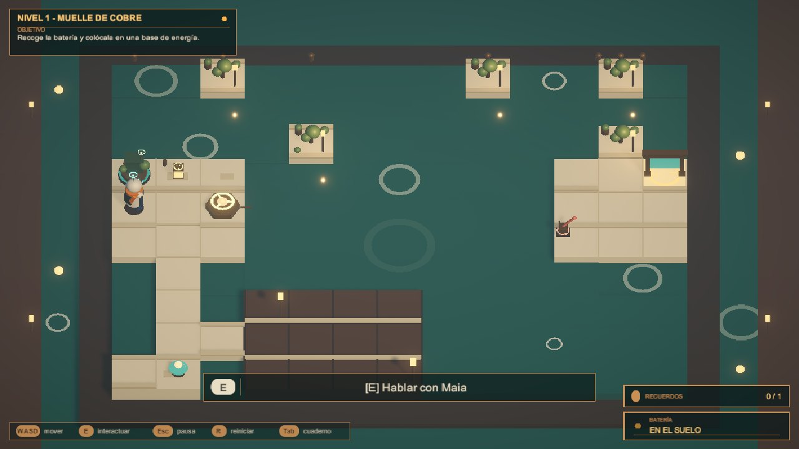

**Objetivo de la mejora:** reemplazar las primitivas por modelos 3D estilizados y animar el
escenario y los personajes para que el mundo se sienta vivo, **sin cambiar las reglas del
juego** (batería única, puentes temporales, pasarelas permanentes, agua que bloquea).

**Criterio de trabajo:**
- La lógica y las colisiones invisibles se conservan; solo cambia la capa visual.
- Primero el Nivel 1 completo; después se replica en los Niveles 2, 3 y el Cuaderno.
- Todo en la rama `mejora-grafica`; `main` queda intacta como respaldo.

---

## 2026-10-12 · Entrada 1 — Descarga e importación de assets gratuitos (CC0)

Se descargaron cuatro packs con licencia **CC0 1.0** (dominio público: uso comercial y
académico libre, sin obligación de atribución). Cada carpeta conserva su `License.txt`.

| Pack | Autor | Fuente | Uso previsto | Peso en el proyecto |
|---|---|---|---|---|
| LowPoly Robot (animado, 14 animaciones) | Quaternius | quaternius.itch.io/lowpoly-robot | Base del modelo de Nilo | 3.2 MB |
| Stylized Nature MegaKit (Standard, 68 modelos) | Quaternius | quaternius.itch.io/stylized-nature-megakit | Árboles, plantas, flores, rocas, caminos de piedra | 46 MB |
| Pirate Kit 2.1 | Kenney | kenney.nl/assets/pirate-kit | Muelles, tablones, barriles, cajas, torre (faro) | 3.2 MB |
| Watercraft Kit 2.1 | Kenney | kenney.nl/assets/watercraft-kit | Barcas, boyas, botes de pesca | 1.9 MB |

**Qué se importó:** solo los modelos `.fbx` y sus texturas, en `Assets/ThirdParty/<Pack>/`.
Los `.zip` originales y los demás formatos (OBJ, glTF, Blend) quedan fuera del proyecto, en
`Downloads/RelevoAssets_src/`, para no inflar el repositorio.

**Archivos:** `Assets/ThirdParty/**` (nuevo).

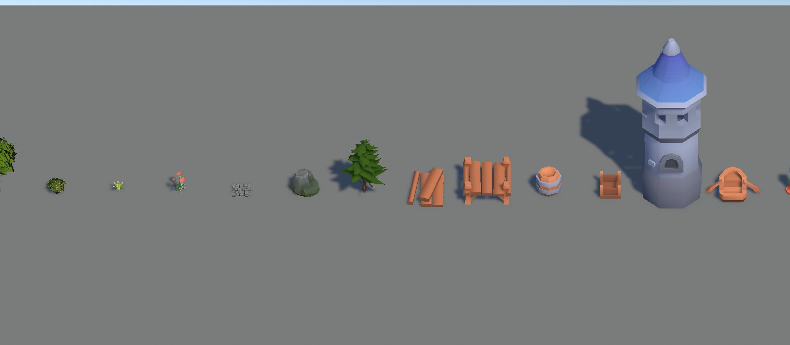

*Vista de prueba de los modelos recién importados (árboles, rocas, tarimas, barriles, torre,
barcas), antes de aplicarles los materiales de RELEVO.*

---

## 2026-10-12 · Entrada 2 — Kit visual y shaders propios

Para que los modelos de dos autores distintos se lean como un solo mundo, y para que el arte se
pueda regenerar entero, se creó un **kit visual** y dos **shaders propios**.

**Kit visual (`Assets/Resources/KitRelevo.asset`).** Catálogo con los modelos y materiales que
usa el generador de niveles. Si el kit no existe, los niveles se construyen como antes, con
primitivas. Lo crea y rellena el menú **Relevo → Preparar kit visual**
(`Assets/Editor/PrepararKitVisual.cs`), que además:
- Crea los materiales de RELEVO en `Assets/Materials/Kit/` (agua, follaje, piedra, madera, Nilo).
- Reasigna los materiales de los modelos importados (remap del importador), así que cualquier
  árbol o el robot ya salen con el aspecto de RELEVO.
- Configura los bucles de las animaciones del robot y crea el Animator de Nilo
  (`Assets/Animation/Nilo.controller`).

**Shader de agua (`Assets/Shaders/RelevoAgua.shader`).** Las superficies de agua son cajas
planas, así que la vida del agua se dibuja en el fragmento:
- El color cambia según la profundidad real (lee el *depth texture* de URP): se aclara junto a
  muelles, rocas y pilotes.
- Una banda de espuma "respira" contra las orillas.
- Vetas finas de corriente que derivan y destellos de sol que parpadean.
- Recibe la sombra del sol, así que los muelles y los árboles se proyectan sobre el canal.
- Funciona con la cámara ortográfica del juego y con la perspectiva del editor.

**Shader de follaje (`Assets/Shaders/RelevoFollaje.shader`).** Para árboles, matas, flores y hierba:
- Viento en el vértice: cada planta se mece más cuanto más alta es, con un desfase por posición
  para que no se muevan todas a la vez.
- Luz "envolvente": la cara en sombra de la copa no se vuelve negra (aspecto de ilustración).
- Recorte por alfa, dos caras, sombras y oclusión ambiental (SSAO).

**Archivos:** `Assets/Scripts/Visual/KitRelevo.cs`, `Assets/Editor/PrepararKitVisual.cs`,
`Assets/Shaders/*.shader`, `Assets/Materials/Kit/*`, `Assets/Animation/Nilo.controller`,
`Assets/Resources/KitRelevo.asset`.

---

## 2026-10-12 · Entrada 3 — Escenario del Nivel 1 vestido con los modelos

`DioramaVestido.cs` (nuevo) se ejecuta después de `DioramaBuilder` y coloca los modelos
**encima** de lo que ya existía. Las cajas de terreno, los volúmenes invisibles que bloquean el
agua y el perímetro son exactamente los mismos.

| Casilla / zona | Antes | Ahora |
|---|---|---|
| Piedra (`#`) | Caja crema con juntas pintadas | Adoquines de piedra (Quaternius) teñidos al crema de la paleta |
| Madera (`m`) | Caja marrón con juntas | Tarima de tablones (Kenney) teñida a madera |
| Vegetación (`v`) | Esferas verdes y cilindro | Árbol, mata, flores y hierba con viento, y farol que titila |
| Orillas | Recta | Rocas, guijarros y juncos en el agua, con espuma alrededor |
| Esquinas de muelle | — | Algunos barriles y cajas (sin colisión, pegados al canto) |
| Fondo | Esferas ámbar y cajas | Barcas y boyas que se mecen (`Flotador.cs`), gaviotas planeando (`Gaviotas.cs`) |
| Aire | — | Polen flotando sobre el canal y luciérnagas junto a los faroles |

Toda la variación (qué árbol, qué giro, dónde va una roca) sale de un ruido determinista por
casilla, no de `Random`: hornear dos veces el mismo mapa da exactamente la misma escena.

**Luz de tarde.** El GDD sitúa la aventura "durante una tarde", así que con el kit activo el sol
es más bajo y dorado, el ambiente más claro y la niebla pasó de exponencial a **lineal**: la
cámara está a unos 45 m del muelle y la exponencial lavaba un tercio del color de todo el nivel.

**Archivos:** `Assets/Scripts/Level/DioramaVestido.cs` (nuevo), `DioramaBuilder.cs` (usa el kit
si existe), `ActorFactory.cs` (luz y ambiente), `Assets/Scripts/Visual/Flotador.cs`,
`LuzTitilante.cs`, `Gaviotas.cs` (nuevos).

### Problemas encontrados y cómo se resolvieron

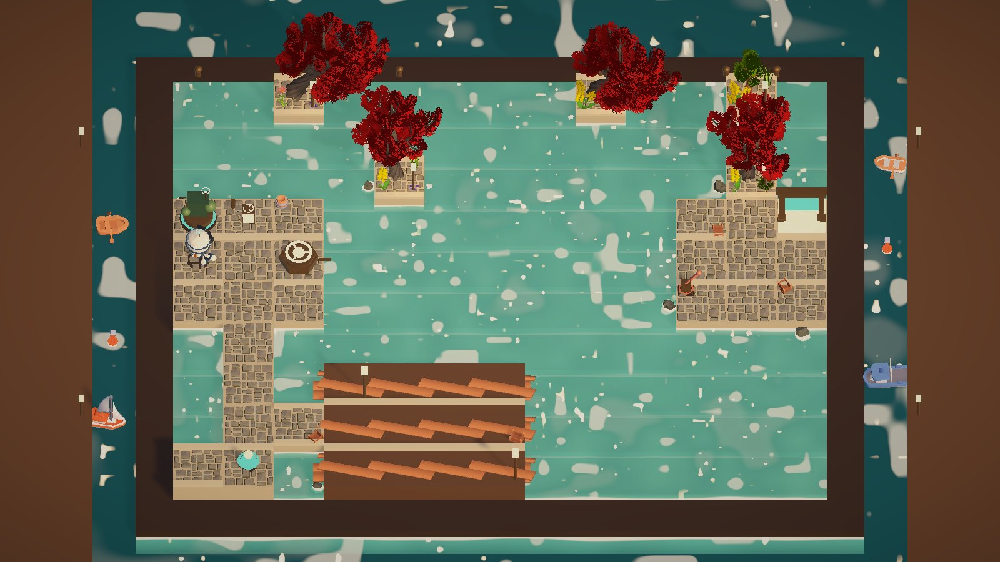

1. **Árboles rojos.** Las texturas `_C` de Quaternius no son colores sino *máscaras* pensadas
   para su shader de pago (la de los árboles retorcidos es roja). Se usan las versiones blancas
   de las hojas y se tiñen desde el material con los verdes apagados de la paleta del GDD.
   Además se activaron *alpha is transparency* y *preservar cobertura* en las texturas con alfa,
   para que las copas no se vean ralas de lejos.
2. **Agua con manchas blancas.** La espuma salía de un umbral sobre una sola capa de ruido y
   dibujaba manchas. Ahora son líneas finas donde se cruzan dos capas, solo en algunas zonas, y
   los destellos son mucho más escasos.
3. **Tablones mal orientados.** La primera pieza de Kenney (`platform-planks`) era una pila de
   tablas, no un suelo. Se cambió por `platform` y su escala se calcula a partir del tamaño real
   del modelo.
4. **Imagen lavada.** Era la niebla exponencial (ver arriba).

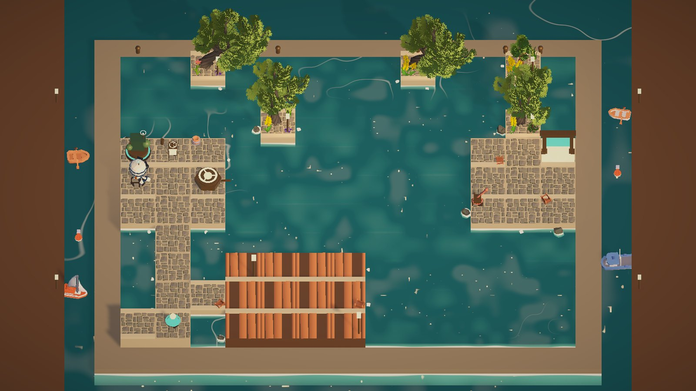

---

## 2026-10-12 · Entrada 4 — Nilo animado

Nilo ahora es el **robot animado de Quaternius**, pintado con los colores del GDD (carcasa
clara, extremidades azul oscuro) y con sus señas propias: **bufanda naranja** colgada del hueso
del cuello y **antena con luz cian** sobre la cabeza.

- **Locomoción:** un árbol de mezcla por velocidad pasa de reposo a paso y a carrera sin cortes.
- **Gestos:** se disparan con las mismas acciones que ya pedían un sonido, así la animación
  reacciona exactamente a lo mismo que el audio, sin tocar la lógica:

| Acción del jugador | Gesto de Nilo |
|---|---|
| Recoger la batería | Asiente ("sí") |
| Insertarla en una base | Pulgar arriba |
| Accionar una palanca | Golpe a la palanca |
| Examinar un recuerdo | Saluda |
| Acción no válida (p. ej. salir sin batería) | Niega con la cabeza |
| Completar el nivel | Baila |

- Si Nilo echa a andar durante un gesto, el gesto se corta: el control nunca se siente pegajoso.
- La bufanda ondea y la antena se balancea con la marcha.
- **La batería va a la espalda**, colgada del hueso del torso, para que el balanceo de los brazos
  al caminar no la atraviese.

El `CharacterController` y todos los componentes de juego de Nilo son los mismos de antes.

**Archivos:** `Assets/Scripts/Actors/AnimadorNiloModelo.cs` (nuevo), `ActorFactory.cs`
(`CrearNiloModelo`; la batería se engancha buscando `ManoBateria` por nombre).

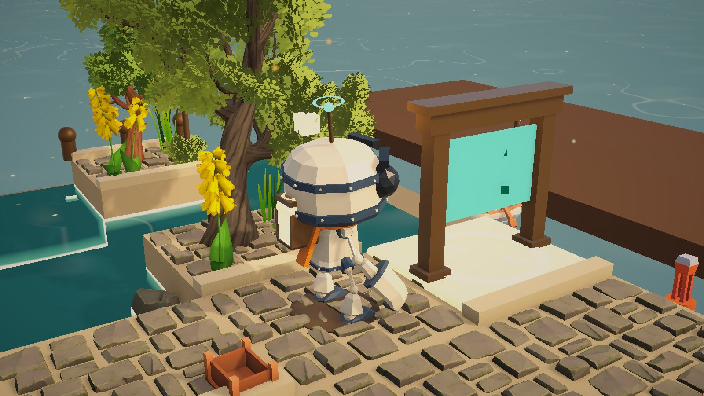

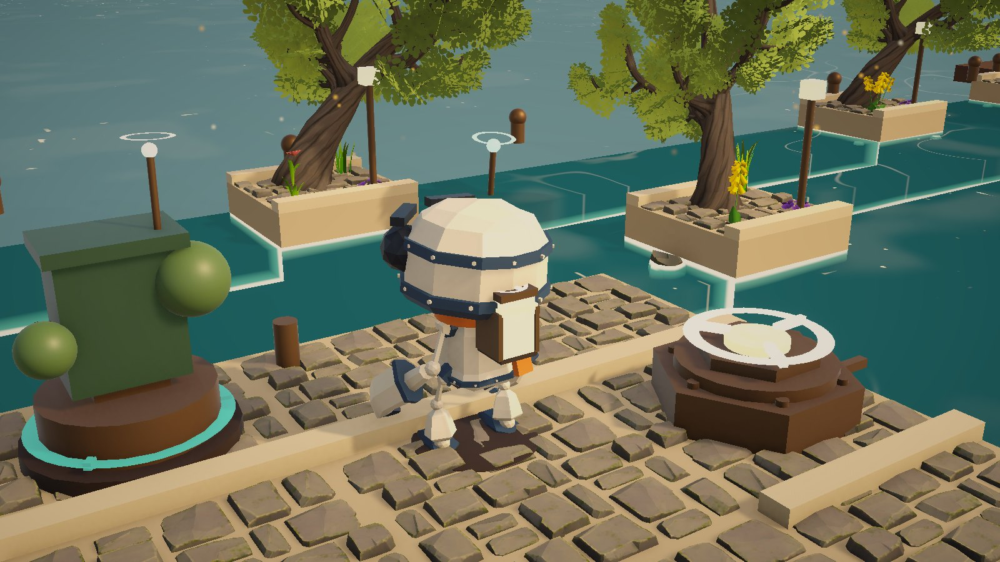

---

## 2026-10-12 · Entrada 5 — Verificación del Nivel 1

**Colisiones intactas.** La escena horneada tiene los mismos **74 colisionadores** que en `main`:
el arte nuevo no añade ni quita ningún obstáculo.

**Partida completa.** Se jugó la solución del Nivel 1 dentro del editor, paso a paso:

| Paso | Resultado |
|---|---|
| Recoger la batería | Batería en manos de Nilo ✔ |
| Insertarla en la base A | Batería en la base, puente A–B desplegado ✔ |
| Accionar la palanca de B | Pasarela permanente D–B abierta ✔ |
| Recuperar la batería en A | Puente A–B retraído, batería en manos ✔ |
| Salir por B con la batería | "Nivel restaurado", progreso guardado ✔ |

Consola sin errores del juego (solo avisos de licencia del paquete de IA de Unity, ajenos al
proyecto).

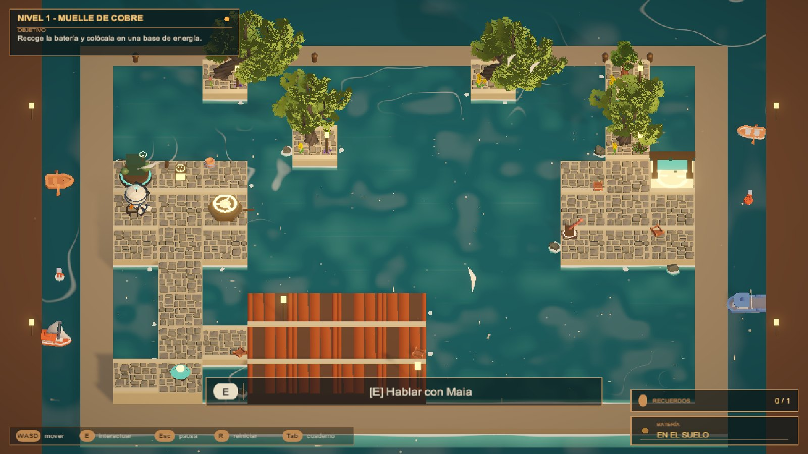

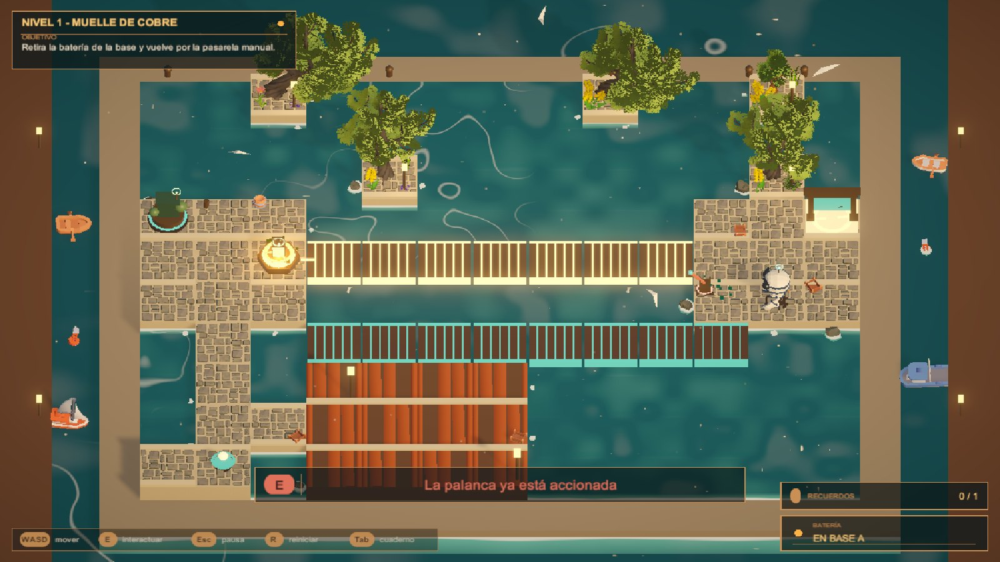

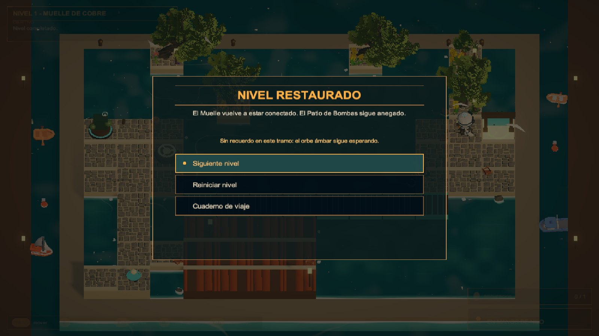

### Pendiente para la siguiente etapa

- **Maia, la base de energía, la palanca, la salida y el recuerdo** siguen hechos con
  primitivas. Junto al arte nuevo desentonan (se nota en el primer plano). Los packs no traen
  equivalentes de estas piezas, así que hay que diseñarlas: es el siguiente paso.
- Replicar todo en el Nivel 2, el Nivel 3 y el Cuaderno.

---

## 2026-10-12 · Entrada 6 — Segunda tanda de assets (HUD y piezas)

Con autorización del equipo se descargaron (todo CC0, salvo las fuentes, que son OFL y también
libres para uso comercial y académico):

| Pack | Autor | Uso |
|---|---|---|
| Input Prompts 1.5 | Kenney | Teclas del teclado (E, Esc, Tab, R, WASD, Enter, flechas) |
| UI Pack 2.0 | Kenney | Panel redondeado con relieve para todos los paneles del HUD |
| Fantasy Town Kit 2.0 | Kenney | Pilares, faroles, estandartes y jardinera |
| Space Kit | Kenney | Máquinas: batería, caja de la palanca, cuerpo y pantalla de Maia |
| Lilita One | Google Fonts (OFL) | Fuente de títulos |
| Varela Round | Google Fonts (OFL) | Fuente de textos |

Solo se copiaron al proyecto las piezas que se usan: modelos en `Assets/ThirdParty/Kenney_FantasyTown`
y `Kenney_Space`, y sprites y fuentes en `Assets/Resources/UI/` (para que el HUD los cargue al
construirse). Cada carpeta conserva su licencia.

---

## 2026-10-12 · Entrada 7 — Piezas del puzle del Nivel 1

`ActorVestido.cs` (nuevo) viste cada pieza **encima** de la que ya construye `ActorFactory`.
Lo que los scripts del juego necesitan se conserva intacto: las anclas, los pivotes y los
renderers que cambian de color para mostrar el estado (anillo de la base, indicador de la
palanca, umbral de la salida, orbe del recuerdo). Las primitivas que solo eran forma se ocultan.

| Pieza | Antes | Ahora |
|---|---|---|
| Batería | Caja ámbar | Celda de máquina (Space Kit) ámbar con franja de carga luminosa |
| Base de energía | Prisma marrón | Prisma de piedra tallada con pernos de cobre (conserva el conector hexagonal del GDD) |
| Palanca | Cajas de cobre | Caja de mecanismo de cobre (Space Kit); la barra y su indicador no cambian |
| Salida | Postes de cobre | Pórtico de pilares de piedra, dintel de madera, estandartes verdes y dos faroles |
| Recuerdo | Pedestal de cobre | Orbe sobre un pilar corto de piedra |
| Maia | Torre verde de cajas | Terminal verde con pantalla y ojos sobre una jardinera de piedra con helechos que respiran |
| Faroles del muelle | Poste y cubo ámbar | Farol de Fantasy Town (con su luz cálida que titila) |

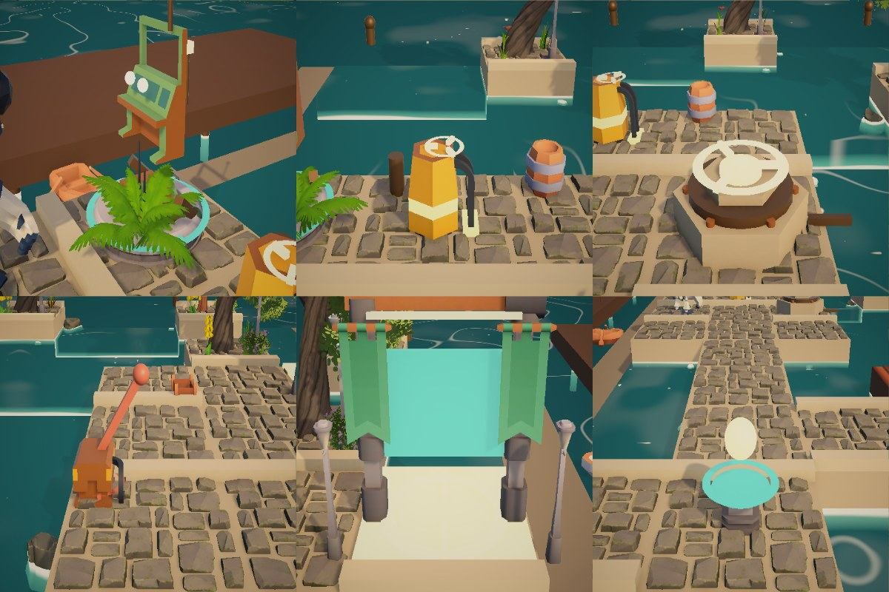

*De izquierda a derecha y de arriba abajo: Maia, batería, base de energía, palanca, salida y recuerdo.*

**Problema resuelto:** en los modelos del Space Kit el cuerpo usa el material `metalRed` y las
franjas usan `metal`, al revés de lo que parecía. El primer intento puso el ámbar emisivo en
todo el cuerpo de la batería y el brillo la saturó a blanco. Se corrigió el mapeo y se bajó la
emisión del ámbar.

**Archivos:** `Assets/Scripts/Level/ActorVestido.cs` (nuevo), `ActorFactory.cs` (llama al
vestido de cada pieza), `DioramaBuilder.cs` (faroles), `KitRelevo.cs` (piezas y materiales
nuevos, `ColocarCentrado`, `Tenir`), `PrepararKitVisual.cs`.

---

## 2026-10-12 · Entrada 8 — HUD nuevo y tecla animada

El HUD se construye por código desde `RelevoUIEstilo.cs`, así que el cambio de estilo se hizo
ahí y llega a todas las pantallas a la vez (objetivo, estado, aviso, diálogo, pausa y cierre):

- **Tipografía:** títulos en **Lilita One** y textos en **Varela Round** (antes, la fuente por
  defecto de Unity). Las dos tienen tildes y eñes.
- **Paneles:** panel redondeado con relieve de Kenney, teñido con el azul verdoso oscuro de
  RELEVO, con un contorno redondeado de cobre.
- **Teclas:** las leyendas de controles usan las teclas dibujadas de Kenney (WASD aparece como
  cuatro teclas). **Cada tecla de la leyenda se hunde cuando el jugador pulsa esa tecla.**
- **Menús:** la opción seleccionada crece con un pequeño rebote de muelle (`ReboteUI.cs`).

**Tecla E animada (`TeclaAnimada.cs`).** En el aviso de interacción ("[E] Recoger batería",
"[E] Hablar con Maia"...) la tecla E está dibujada en dos capas: la tapa y, debajo, la misma
tecla oscurecida, que hace de canto. Así se ve como una tecla física:
- En reposo, cada 1,5 s hace una **pulsación suave**, para invitar a presionarla.
- Cuando el jugador **presiona E de verdad**, la tecla se hunde a fondo, se achata, se oscurece,
  vuelve con un rebote y suelta una **onda** hexagonal.
- La tecla toma el color de la acción: ámbar para la batería y la energía, turquesa para los
  mecanismos, coral para los avisos.

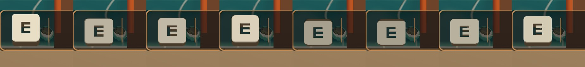

*Ocho fotogramas cada 0,06 s: reposo, hundimiento, fondo y vuelta con rebote.*

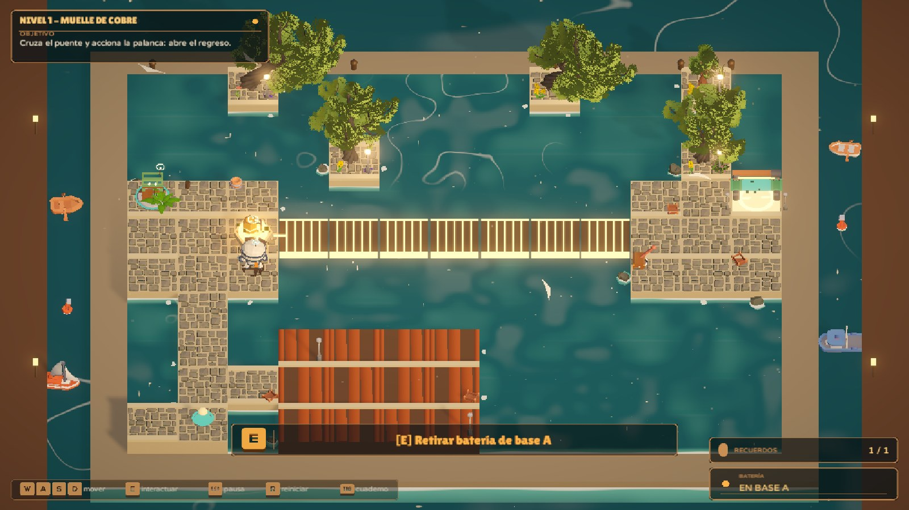

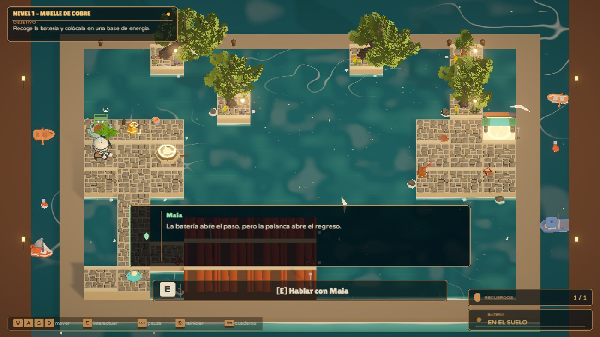

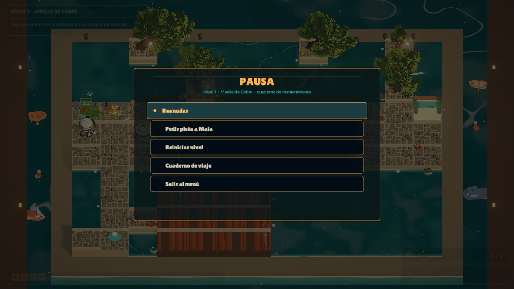

**Problema resuelto:** el primer sprite de "contorno" elegido para los marcos no era hueco y
tapaba los paneles de color cobre, escondiendo las etiquetas. Se reemplazó por un contorno
redondeado generado por código, del mismo radio que los paneles.

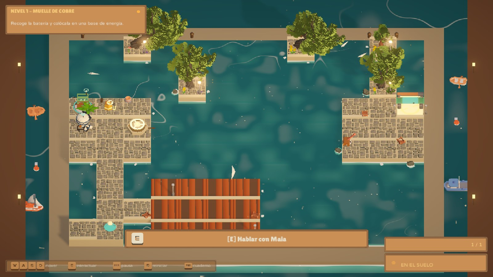

**Herramientas de la bitácora** (solo editor, no entran en el juego): `SecuenciaCapturas.cs`
pulsa una tecla simulada y saca capturas cada pocos centésimos de segundo, con la interfaz
incluida; `CapturaBitacora.HojaDeContactos` compone varias imágenes en una hoja.

**Archivos:** `Assets/Scripts/UI/RelevoUIEstilo.cs`, `UIManager.cs`, `TeclaAnimada.cs` (nuevo),
`ReboteUI.cs` (nuevo), `Assets/Scripts/Herramientas/SecuenciaCapturas.cs` (nuevo),
`Assets/Resources/UI/**` (sprites y fuentes).

### Verificación

Se volvió a jugar la solución completa del Nivel 1 (recoger, insertar, palanca, recuperar,
salir): todo funciona, sin errores en la consola, y la escena sigue con sus 74 colisionadores.

### Pendiente

- Llevar el arte, las piezas y el HUD al Nivel 2, el Nivel 3 y el Cuaderno (el HUD nuevo ya
  aplica a todos los niveles porque se construye por código). El Cuaderno ya toma las fuentes y los paneles nuevos; su leyenda aún usa las teclas en cápsula.

---

## Entrada 9 — Malecón de piedra y fin de los muelles vecinos

**Pedido:** los bordes del muelle se veían muy básicos y las franjas cafés de los lados
desentonaban con el juego.

**Antes:** el margen del zócalo alrededor del recinto era una franja lisa color arena, y a los
lados había dos "muelles vecinos" hechos con cajas de madera lisa (las franjas cafés).

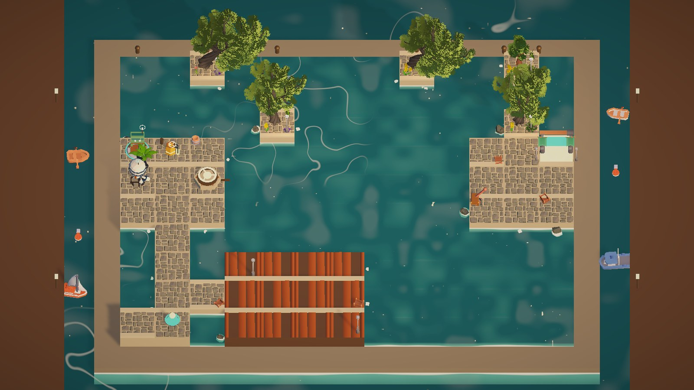

**Cambios:**

- Se quitaron los muelles vecinos cuando el kit visual está activo. El fondo queda como mar
  abierto con las barcas, las boyas y las gaviotas.
- El margen del zócalo ahora es un malecón:
  - Está adoquinado con las mismas losas de RockPath del recinto, escaladas al ancho de la franja.
  - En el canto que da al mar lleva una albardilla de sillares sueltos de unos 0,7 m, con junta,
    dos tonos de piedra y alturas un poco distintas, para que se lea tallado a mano.
  - En la cara exterior hay pilotes de madera de amarre cada 5,5 m aproximadamente.
- Todo es decoración sin colisionadores: la escena sigue con 74, como antes.

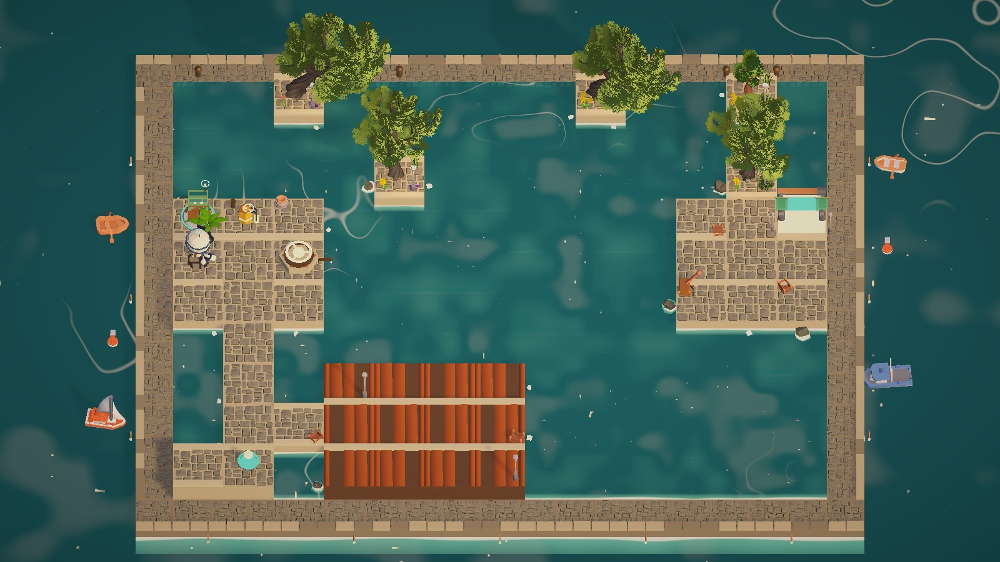

**Problema en el camino:** el modelo "poste" del kit resultó ser un mástil con travesaños, y
plantado alrededor del malecón parecía una cerca de cruces. Se cambió por el pilar de madera de
Fantasy Town.

**Archivos:** `Assets/Scripts/Level/DioramaVestido.cs` (función `Malecon`),
`Assets/Scripts/Level/DioramaBuilder.cs` (sin muelles vecinos con kit),
`Assets/Scenes/Nivel1_MuelleDeCobre.unity` (horneada de nuevo).

---

## Entrada 10 — Diálogos con retratos, estilo RPG

**Pedido:** que los diálogos se vean como en la referencia (busto del personaje junto a burbujas de
texto), que se cierren con un botón y que el movimiento y lo demás se desactiven mientras haya
diálogo.

**Antes:** una caja ancha con borde de cobre que se cerraba sola a los pocos segundos y no
detenía el juego (ver la captura de la Entrada 8).

**Cambios:**

- Componente nuevo `DialogoUI`, que reemplaza la caja anterior para todos los mensajes del nivel:
  Maia, avisos, mecanismos, recuerdos y la introducción.
- **Retratos en vivo:** no son imágenes fijas. Una cámara encuadra el busto del personaje real y
  lo dibuja con fondo transparente, así que se ve con sus animaciones. Maia aparece abajo a la
  izquierda cuando habla, y Nilo abajo a la derecha (atenuado cuando escucha). Los bustos entran
  deslizándose y "respiran" mientras se escribe su frase.
- **Burbujas:** una por frase, oscuras y translúcidas, con esquinas achaflanadas, un pico hacia el
  que habla y un contorno del color del emisor. Aparecen con un pequeño rebote y el texto se
  escribe letra a letra. El nombre del emisor va encima, en Lilita One y con su color.
- **Cerrar:** abajo aparece la tecla E animada con "Cerrar" (o "Continuar" si hay más mensajes en
  cola). E, Enter o un clic completan la frase y, a la siguiente pulsación, cierran o pasan al
  siguiente mensaje. Esc cierra el diálogo.
- **Juego detenido:** mientras hay diálogo, Nilo no se mueve, no se puede interactuar, el HUD se
  atenúa y no responden la pausa, el reinicio ni el cuaderno. La pulsación que cierra el diálogo
  no llega al juego, así que cerrar con E junto a Maia no la vuelve a abrir.
- Los mensajes ya no se cierran solos por tiempo, y los que llegan con un diálogo abierto se
  ponen en cola. Al completar el nivel no se abre diálogo, porque el menú final ya muestra el cierre.

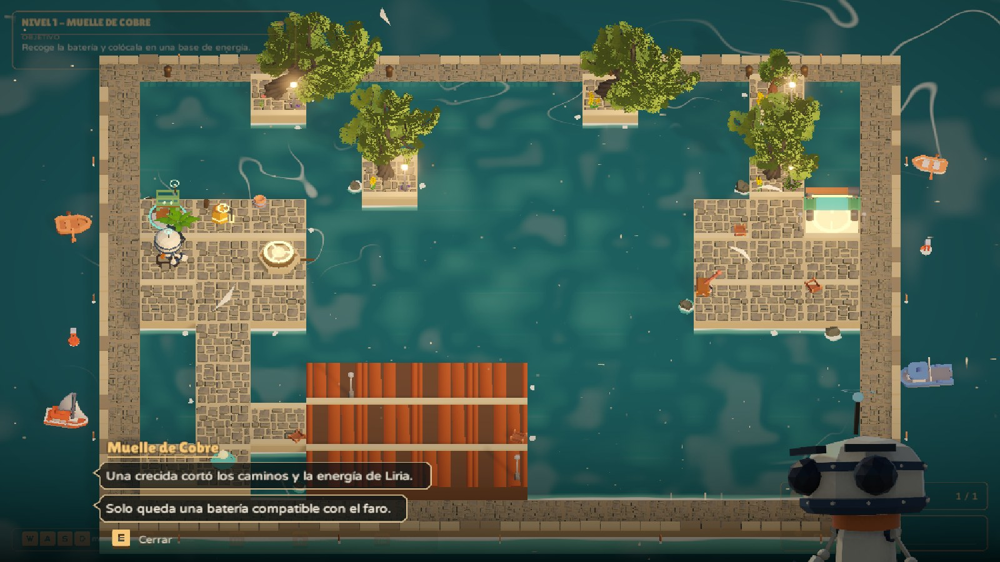

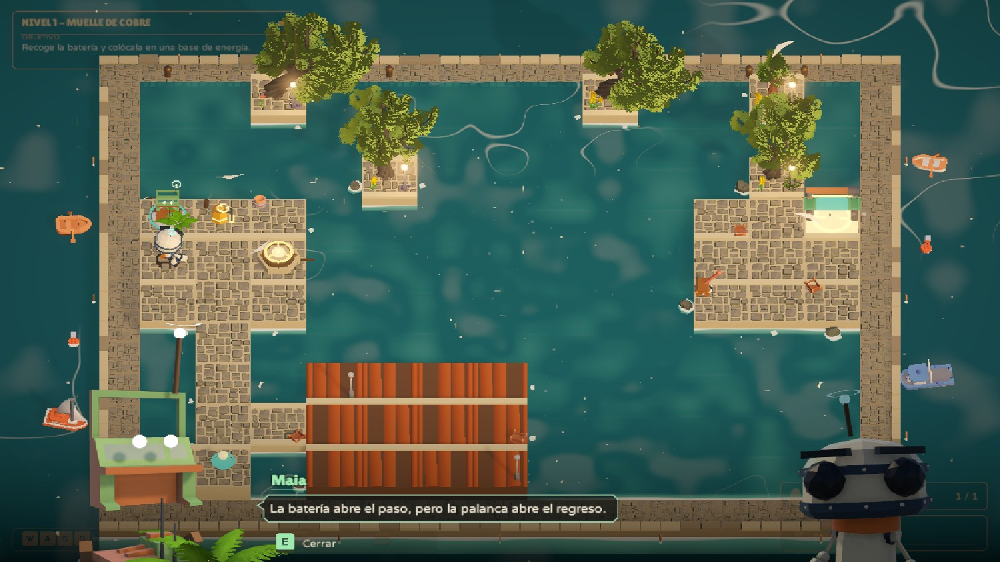

**Problemas en el camino:**

- Con las cámaras de retrato encendidas, todo el suelo del nivel salía turquesa. Se arregló
  haciendo que esas cámaras rendericen antes que la principal (`depth = -50`), sin pedir
  texturas de profundidad ni de color.
- Nilo suele estar al lado de Maia, y cada cámara veía a los dos personajes. Ahora cada retrato
  usa su propia capa (30 y 31) y el personaje vuelve a su capa original al cerrar el diálogo.
- Maia mira al sur (sus ojos están en -Z), no hacia su eje "adelante". Su cámara se orienta hacia
  el punto medio de sus dos ojos.

**Verificación (en Play):** se probó con pulsaciones de teclado simuladas. La E cerró el diálogo
y luego volvió a abrir el de Maia sin rebotes; Enter también lo cerró; Esc lo cerró. El
movimiento se bloquea con el diálogo abierto y vuelve al cerrarlo. No hay errores en la consola.

**Archivos:** `Assets/Scripts/UI/DialogoUI.cs` (nuevo), `Assets/Scripts/UI/UIManager.cs` (sin la
caja anterior; el diálogo entra en `BloqueaJuego`).

---

## Entrada 11 — Clips para el teaser

**Pedido:** 6 segundos de cinemática en plano detalle del personaje y del nivel, con cortes
cinematográficos, y 5 segundos de jugabilidad del Nivel 1.

**Herramienta:** `Assets/Scripts/Herramientas/GrabadorTeaser.cs` (solo editor). Graba en Play,
fotograma a fotograma, a MP4 H.264 de 1920×1080 a 30 fps, con el `MediaEncoder` del propio Unity:
no hace falta Unity Recorder ni ffmpeg. `Time.captureFramerate` fija el paso del tiempo, así que el
clip sale fluido aunque el editor renderice más lento.

**Archivos generados** (fuera del repositorio, en `RelevoZIP6/Teaser/`):

- `01_cinematica.mp4`: 6 s en cuatro planos de 1,5 s con corte seco, bandas de cine 2,39:1,
  profundidad de campo (bokeh) y viñeta:
  1. Primer plano de Nilo, con un dolly lento hacia la cara en contrapicado.
  2. Detalle de la batería a ras de suelo, con una cámara que se desliza en arco.
  3. Maia: un arco frente a su pantalla con los ojos encendidos.
  4. Grúa que sale a ras del malecón y sube hasta mostrar el nivel completo.
- `02_jugabilidad.mp4`: 5 s con la cámara y el HUD reales del juego. Un piloto automático pulsa
  teclas simuladas: Nilo recoge la batería, la coloca en la base A, el puente se despliega tramo
  a tramo y Nilo lo cruza.

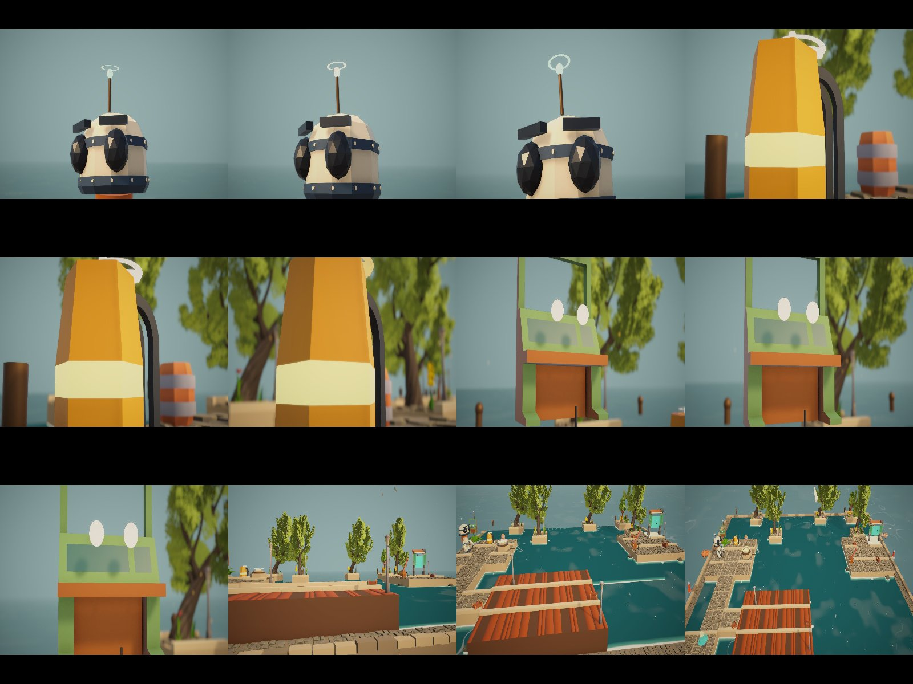

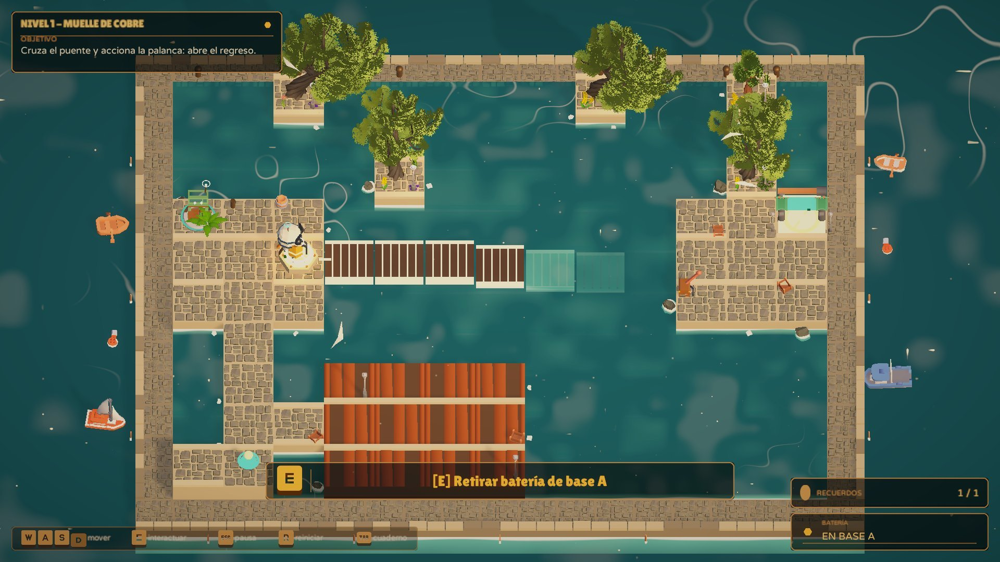

**Ajustes durante la grabación:**

- La cámara del juego nunca ve el cielo, así que en los planos cercanos el fondo salía gris
  pizarra. La cámara de cine usa como fondo el color de la niebla.
- En el primer plano de Nilo se cruzaban postes. Ahora Nilo se gira hacia el canal antes del plano.
- La grúa empezaba frente a la pared del zócalo. Ahora arranca por encima del malecón.
- Para que el HUD salga en el clip de jugabilidad, el lienzo pasa a "Screen Space - Camera"
  durante la grabación y vuelve a su modo al terminar.

---

## Entrada 12 — Nivel 2: Patio de Bombas, con reserva de energía y cajas

**Pedido:** aplicar los gráficos nuevos al Nivel 2 y rediseñarlo para que sea desafiante y
creativo, con dos mecánicas nuevas (la reserva de energía de Nilo y las cajas con placas de
presión, propias del Patio de Bombas). Maia las explica en un diálogo interactivo y gráfico. Si
Nilo se descarga, se apaga como un robot: antena en rojo, ojos apagados y cabeza agachada. Las
mareas y los condensadores quedan para más adelante.

**Decisiones del usuario:** la reserva se gasta **por distancia**, al apagarse **se reinicia el
nivel**, y las cajas **solo se empujan sobre placas** (no flotan en el agua).

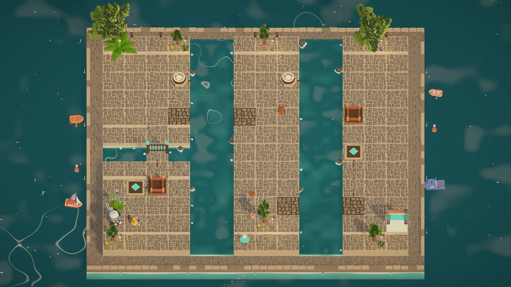

### El nivel

Tres muelles separados por dos canales: oeste, central y este.

1. **Oeste (tutorial de cajas):** una compuerta de barrotes turquesa separa el sur del norte. Se
   abre empujando la caja sobre la placa.
2. **Base A:** la batería despliega el puente eléctrico hacia el muelle central. Lejos de la
   batería, la reserva cuenta: hay que cruzar, accionar la palanca y volver por la pasarela, que
   es corta.
3. **Base D:** con la pasarela abierta, la batería viaja en manos de Nilo al muelle central. En la
   base D despliega el puente al muelle este.
4. **Muelle este:** la caja se empuja dos casillas hasta su placa, que despliega un puente manual
   (turquesa) cerca de la salida. **La trampa:** volver a la base D por ese puente nuevo agota la
   reserva y Nilo se apaga. Hay que volver por el puente eléctrico, que es el camino corto.
5. **Salida:** se retira la batería de D (su puente se repliega) y se cruza con ella por el
   puente de la placa hasta la salida. Hay un recuerdo opcional en el sur del muelle central.

Con 12 casillas de reserva, la ruta correcta deja unas 2 de margen y la ruta equivocada necesita
unas 17.

### Reserva de energía de Nilo

- Cerca de la batería (a 1,5 casillas) o llevándola, Nilo se recarga. La zona segura se ve como
  un aro ámbar discontinuo que gira alrededor de la batería.
- Fuera de la zona, cada casilla recorrida gasta un segmento y empujar una caja gasta medio más.
  Quedarse quieto no gasta.
- En el HUD hay un panel nuevo, "Reserva de Nilo", con un segmento por casilla. Es turquesa con
  carga, ámbar a media carga y coral parpadeando cuando queda poca, y dice "Recargando" o "Lejos
  de la batería".
- La antena de Nilo cambia de color con la reserva y, por debajo del 30 %, parpadea y pita.

### Nilo se apaga

Si la reserva llega a cero lejos de la batería:

1. La antena destella en rojo (con una luz roja real) y sale humo gris de la cabeza.
2. La animación se va frenando hasta pararse, los ojos se apagan, la cabeza cae hacia el pecho y
   el cuerpo se asienta.
3. Maia lo explica con su tarjeta y, al cerrar el diálogo, el patio se reinicia.

Para poder apagarle los ojos, Nilo tiene ahora **ojos luminosos** turquesa sobre las lentes. Se
colocan buscando las lentes en la propia malla de la cabeza, así que encajan sea cual sea la pose.

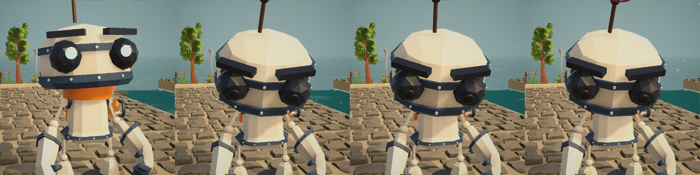

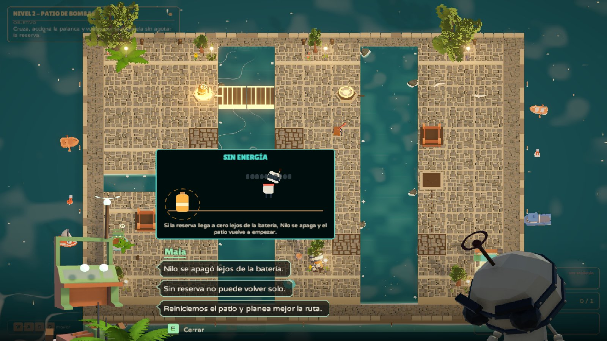

### Cajas, placas y compuertas

- **Cajas:** se empujan caminando contra ellas, una casilla cada vez y solo en las cuatro
  direcciones. Hay que empujar un instante, así que rozarlas no las mueve. Solo entran en suelo
  firme, nunca en el agua ni en los puentes.
- **Placas:** están pisadas mientras haya una caja encima o Nilo esté de pie sobre ellas. Tienen
  marco claro, losa de cobre y un rombo turquesa. Al pisarlas se encienden en turquesa junto con
  un cable en el suelo que lleva hasta lo que accionan.
- **Compuerta:** sus barrotes se hunden en el suelo. Nunca se cierra encima de Nilo ni de una caja.
- **Puente de placa:** es el mismo puente que los eléctricos, pintado en turquesa porque es un
  mecanismo manual.

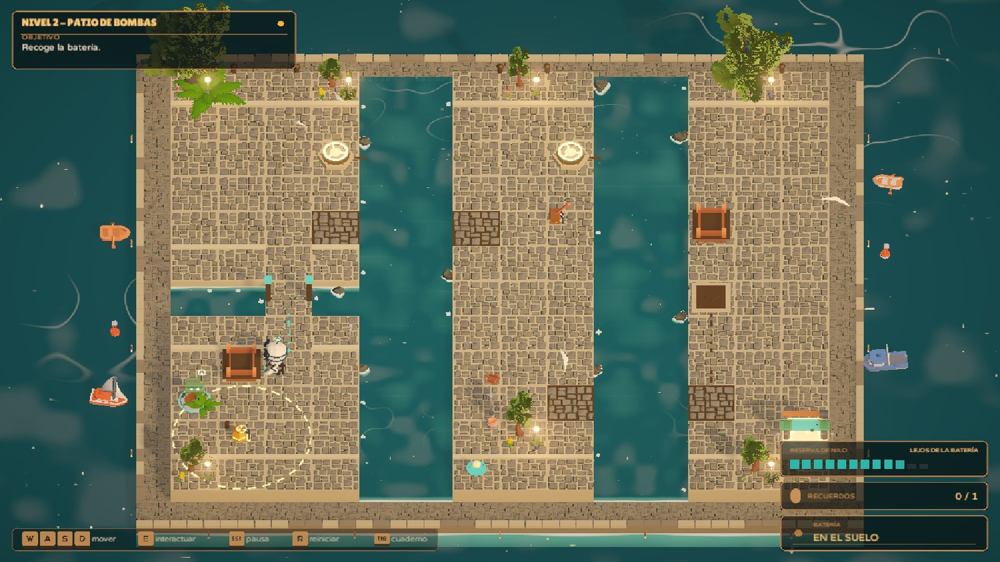

### Maia explica, con imágenes

Al entrar al patio, Maia explica las dos mecánicas con **tarjetas ilustradas animadas** encima
de las burbujas:

- **Reserva:** Nilo se aleja de la batería y su barra baja paso a paso; luego vuelve y se recarga.
- **Sin energía:** la antena se pone roja, se apagan los ojos y cae la cabeza.
- **Cajas y placas:** Nilo empuja la caja, la placa se enciende y baja la compuerta.

Al final pregunta "¿Lo tienes claro, Nilo?", con las opciones **Entendido** o **Explícamelo otra
vez**, que se eligen con ↑↓ y E. Hablar con ella después abre un menú: la reserva, las cajas, una
pista o "nada, gracias".

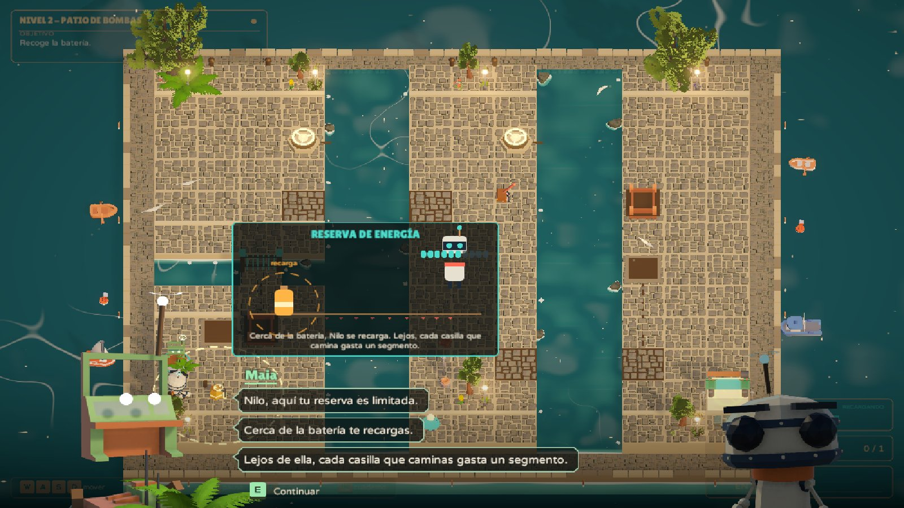

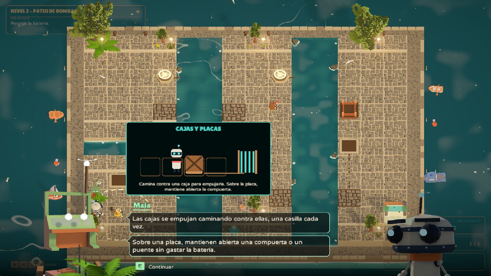

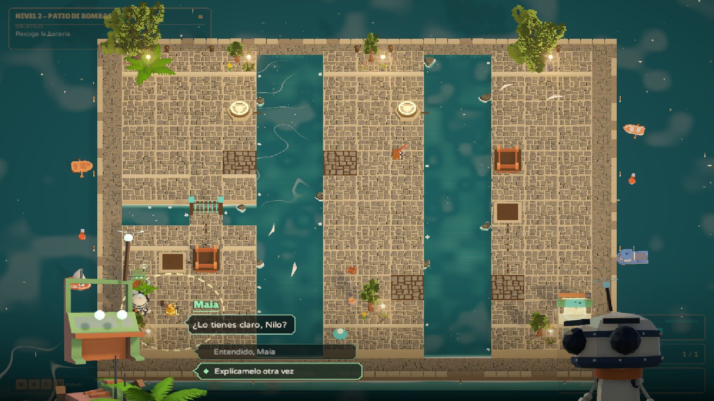

### Verificación

- **Solución completa con piloto automático:** se probó con teclas simuladas y la recorrió de
  principio a fin: caja oeste, base A, palanca, recuperar la batería, base D, caja este, vuelta
  corta, recuperar la batería y salida, hasta "Nivel restaurado". La reserva mínima fue 2,3 de 12.
- **Apagado:** se agotó la reserva lejos de la batería. Nilo se apagó, apareció el diálogo y el
  nivel se reinició.
- **Nivel 1:** se volvió a completar con el piloto. Sin reserva y sin cambios de comportamiento.
- **Consola:** una sesión limpia del Nivel 2 no dio excepciones. Las que aparecieron antes en el
  log eran de recompilar con el editor todavía en Play.

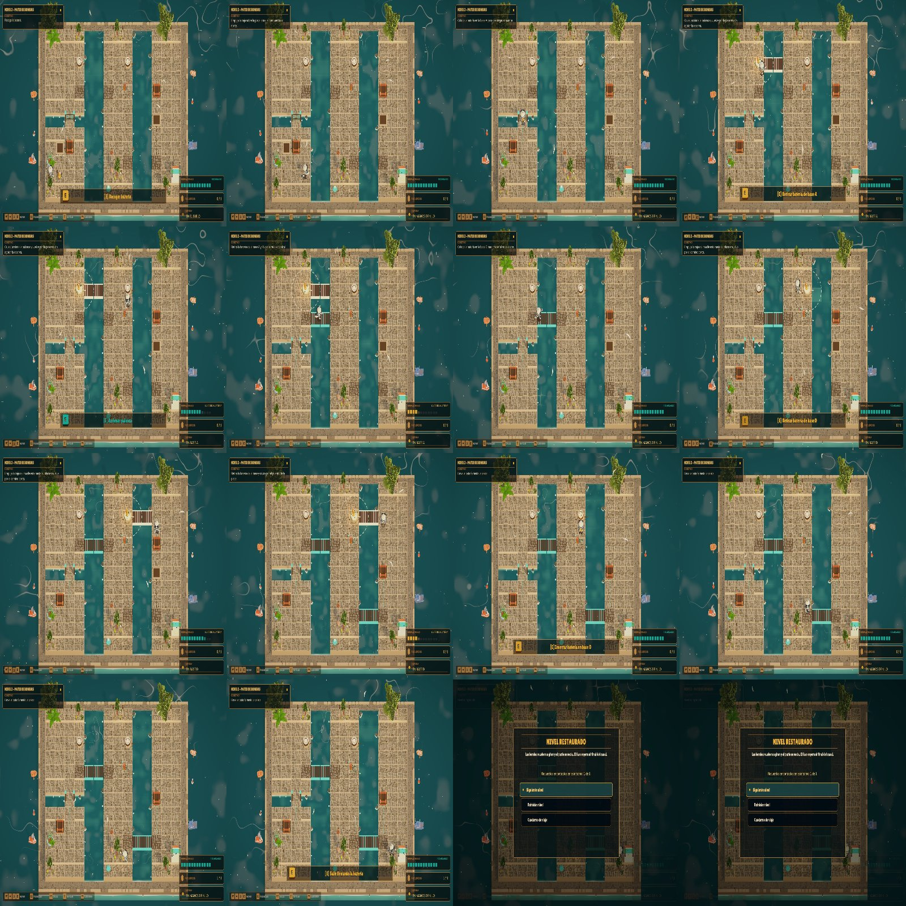

### Problemas en el camino

- **Tarjeta ilustrada fuera de lugar:** salía en la esquina, encima del retrato. La animación de
  entrada guarda la posición la primera vez y la tarjeta cambia de sitio en cada mensaje; ahora
  tiene su propio fundido.
- **Etiqueta del aviso:** la intro decía "Cerrar" aunque Maia tenía mensajes en cola. La etiqueta
  ahora se actualiza sola.
- **Teclado simulado:** sin el foco del editor, el Input System descarta las teclas simuladas. Las
  herramientas de prueba lo habilitan mientras pulsan.
- **Ojos de Nilo:** la malla de la cabeza es hija del hueso "Head" y se llama igual, y el modelo
  necesitaba lectura de malla activada (ahora la activa `PrepararKitVisual`).
- **Placas poco legibles:** se veían como huecos oscuros. Ahora tienen marco claro y rombo
  turquesa.

**Archivos nuevos:** `Interactions/CajaEmpujable.cs`, `Interactions/PlacaPresion.cs`,
`Interactions/Compuerta.cs`, `Player/ReservaEnergia.cs`, `Level/ActorPatio.cs`,
`UI/IlustracionTutorial.cs`, `UI/TutorialMaia.cs` y `Herramientas/PilotoPrueba.cs` (solo
editor).

**Archivos modificados:** `LevelLayouts.cs` (mapa nuevo del Nivel 2), `LevelLayout.cs`
(casillas k, o, u, g y R), `LevelDefinition.cs` (reserva, tutorial y textos), `LevelBootstrap.cs`,
`LevelManager.cs` (objetivos del patio paso a paso), `PlayerController.cs` (empujar),
`MaiaTerminal.cs`, `DialogoUI.cs` (ilustraciones, opciones y acción al cerrar), `UIManager.cs`
(panel de reserva y bloqueo al apagarse), `AudioDirector.cs` (sonidos de empujar, placa,
compuerta, alerta y apagado), `GrabadorTeaser.cs` (ruta del patio), `PrepararKitVisual.cs`, el
`Robot.fbx.meta` y la escena `Nivel2_PatioDeBombas.unity` (horneada de nuevo).

### Pendiente

- El Nivel 3 queda fuera de la beta por ahora.
- Mareas y condensadores: más adelante.
- Las pruebas guardaron progreso local (Nivel 2 completado y su recuerdo).

---

## Entrada 13 — Ajustes del Patio de Bombas tras la primera revisión

**Pedido:** borrar el progreso guardado para probar desde cero; que el tutorial de Maia salga una
sola vez y no cada vez que Nilo revive; quitar el diálogo de la palanca; y corregir un error: al
retirar la batería estando sobre su puente, el puente se replegaba y Nilo quedaba flotando en el
agua.

**Cambios:**

- **Progreso borrado:** se eliminó `relevo_save.json`, que solo tenía datos de las pruebas
  (Niveles 1 y 2 completados y sus dos recuerdos). El juego arranca con todo en cero.
- **Reintentos sin repetir textos:** al reiniciar (con R o cuando Nilo se apaga) el nivel no
  repite la introducción ni el tutorial. Además, el tutorial de Maia se cuenta una sola vez por
  sesión, aunque se vuelva al nivel desde el cuaderno. Hablar con Maia sigue ofreciendo el menú
  para repasar cada mecánica.
- **Palanca sin diálogo:** accionarla ya no abre el mensaje "Mecanismo". La pasarela que sube, el
  sonido y el objetivo del HUD bastan.
- **Batería desde el puente:** una base no deja retirar su batería si Nilo está sobre el puente
  que ella alimenta. El aviso contextual lo dice y, al pulsar E, se abre el diálogo: *"No puedes
  retirar la batería desde el puente: se replegaría bajo tus pies"*. Además de quitar el error,
  cierra un atajo que hacía el nivel demasiado fácil.

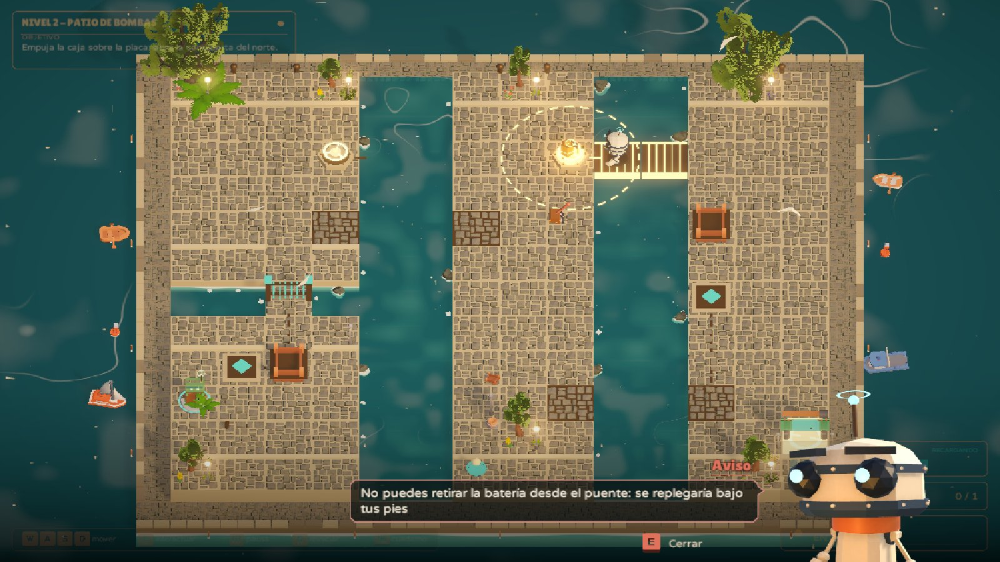

**Verificación (en Play):**

- Con la batería en la base D y Nilo sobre su puente, la base no permite retirarla: la batería
  sigue en la base y aparece el aviso.
- La palanca ya no abre ningún diálogo.
- Tras reiniciar, no hay diálogo abierto, la reserva vuelve a 12 y la batería al suelo.
- El progreso guardado sigue vacío.

**Archivos:** `EnergySocket.cs`, `TemporaryBridge.cs` (`Contiene`), `LeverInteractable.cs`,
`LevelManager.cs` (`ReinicioPendiente`), `LevelBootstrap.cs` y `TutorialMaia.cs` (`PrimeraVez`).

---

## Entrada 14 — Cinemáticas de las mecánicas: apagado y cajas

**Pedido:** dos cinemáticas profesionales, con cámara de cine (no la del juego), planos detalle y
planos en primera persona: cómo se descarga y se apaga Nilo, y cómo empuja las cajas.

**Herramienta:** `Assets/Scripts/Herramientas/CinematicaMecanica.cs` (solo editor). Usa una cámara
de cine propia con profundidad de campo (bokeh), viñeta, grano de película, una leve aberración
cromática, cámara en mano sutil y bandas 2,39:1. Graba a MP4 de 1920×1080 a 30 fps. La acción
la hace el propio juego con teclas simuladas, y el director elige el plano según la fase de la
acción, así que los cortes caen siempre en el momento justo.

**`05_cinematica_apagado.mp4` (11,7 s):**

1. Detalle de la batería en su base; Nilo se aleja desenfocado y el foco lo sigue.
2. Primera persona cruzando el puente.
3. Detalle de la antena, que ya parpadea en coral.
4. Primera persona mirando atrás: la batería lejos, con viñeta roja.
5. Plano lateral: Nilo camina con la antena en alarma.
6. Primer plano frontal con empuje lento: destellos rojos, los ojos se apagan y la cabeza cae.
7. Primera persona mientras cae la cabeza: la vista baja al suelo, pierde el color y se va a negro.
8. Plano general que sube: Nilo apagado y humo, con fundido final.

**`06_cinematica_cajas.mp4` (8,7 s):**

1. Detalle a ras de suelo desde detrás de la placa: la caja enfocada y Nilo que llega.
2. Plano lateral bajo: Nilo apoya el peso y la caja se desliza.
3. Primera persona detrás de la caja, con la placa al fondo.
4. Macro de la placa en cámara lenta: la caja asienta y la placa se enciende en turquesa.
5. El cable encendido lleva al puente de la placa, que se despliega.
6. Grúa: Nilo cruza el puente turquesa, con fundido final.

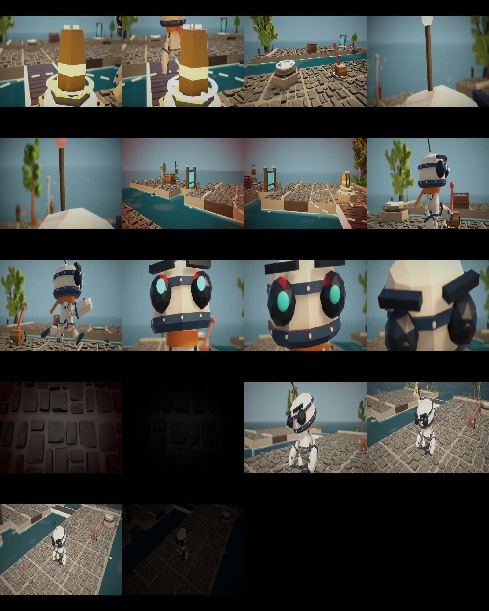

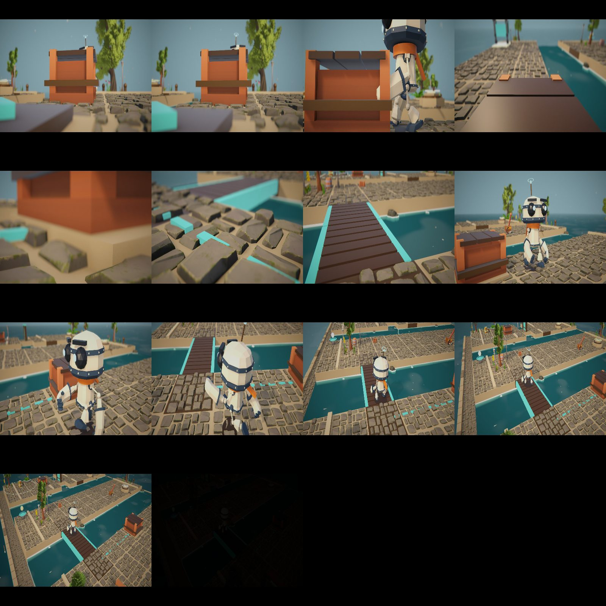

**Ajustes durante la grabación:**

- **Cuadros verdes sobre la batería:** las chispas de la base compartían material con otros
  efectos y se teñían de verde. Ahora usan la partícula suave del kit; se volvieron a hornear los
  dos niveles.
- **Caja abierta:** de cerca se veía que el modelo de Kenney es un cajón sin tapa. Ahora lleva una
  tapa de tablones.
- **Primera persona:** la cámara se adelantó para no ver las lentes desde dentro.

Los videos están fuera del repositorio, en `RelevoZIP6/Teaser/`.
